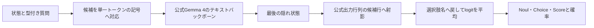

# Gemma 4 Typed Decisions

Google公式Gemma 4を使い、文章を生成せずに型付きの判断と候補確率を返す独立実装です。
Noul（真偽）、Choice（分類）、Score（順序付き評点）を `/v1/systemone` で扱います。
TypeSafe Jevの公式サービスとの比較用ハーネスを含みます。
本プロジェクトはGoogle、TypeSafeによる公式実装ではありません。

## 実測結果

2026-10-28、英語の未使用公開test 3,300件を、同じ入力で `jev-1.14.0` と比較しました。

| 指標 | Gemma 4 Typed Decisions | Jev |
|---|---:|---:|
| 正解率 | 78.030% | 79.939% |
| 平均HTTP応答時間 | 123.4 ms | 149.4 ms |
| p95 HTTP応答時間 | 135.1 ms | 185.8 ms |

正解率の相対低下は2.39%、平均応答時間は17.45%短縮。
事前に固定した5%条件を、型別の精度低下・平均時間の95%上限を含めて満たしました。
ウォーム状態のGX10からのHTTP時間であり、ローカルとクラウドの通信経路を含みます。
日本語・全用途・確率校正の同等性は、この結果の対象に含みません。
[測定条件と型別結果](RESULTS.md)、[集計JSON](results/final/summary.json)を参照してください。

## アーキテクチャ



最終構成は `google/gemma-4-26B-A4B-it` の固定revisionを読み込み時にFP8化します。
最後の隠れ状態を、元のBF16出力行列から選んだ26行へ独自に射影し、
Gemmaのlogit softcapと候補上のsoftmaxを適用します。生成トークン数は0です。
ChoiceとScoreでは正順・逆順の候補割当を同じバッチで計算し、名前の対応を戻してlogitを平均します。
Noulは1順序です。返す確率は未校正の候補条件付き分布です。

先行事例から型や候補採点の考え方を参考にしました。
先行するJev再現コード、派生重み、学習済み分類ヘッド、Jevによる学習ラベルは使用しません。
PyTorch、Transformers、vLLMなどの汎用ライブラリを利用します。
参照先と独立実装の範囲は [PROVENANCE.md](PROVENANCE.md) に記載しています。

## 動作環境

検証環境はASUS Ascent GX10、NVIDIA GB10、ARM64、128 GB統合メモリです。
Docker、Compose、NVIDIA Container Toolkitと、固定したARM64イメージを使います。
この構成の動作・速度を他のGPUやx86環境へ一般化する検証は行っていません。

- 元重み約48 GiBに加え、50 GiB以上のディスク予備が必要です。
- 起動前の空きメモリ116 GiB以上を要求します。他の大型モデルとの同時稼働は避けてください。
- 最終FP8構成はCPU読み込みバッファ5 GiB、PyTorch割当上限50%、KVキャッシュ4 GiBです。
- 実行時は空きメモリ36 GiB、GPU 80℃、thermal zone 90℃を監視し、違反やセンサー取得失敗で停止します。
- APIは `127.0.0.1:30000` だけで待ち受け、同時推論は1要求です。既存サービスは自動停止しません。

## 準備と起動

このリポジトリのルートで実行します。重み・データ・カーネルキャッシュは `.cache/` に保存します。
元モデルの取得にはモデル配布元の利用条件が適用されます。重みは本リポジトリに含みません。

```sh
docker compose --profile manual run prepare
docker compose --profile manual run tests
docker compose -f docker-compose.yml -f compose.vllm.yml -f compose.final.yml --profile manual build decisions
docker compose -f docker-compose.yml -f compose.vllm.yml -f compose.final.yml --profile manual up -d --no-build --pull never decisions
curl http://127.0.0.1:30000/health
curl http://127.0.0.1:30000/v1/models
```

初回はダウンロード、重み読み込み、カーネルコンパイルの時間が必要です。
比較表にはこの起動時間を含めていません。設定は `config.final.json` で固定しています。
BF16構成は `config.json`、単一順序FP8構成は `config.vllm.json` に分けています。

```sh
curl http://127.0.0.1:30000/v1/systemone \
  -H 'Content-Type: application/json' \
  --data '{"model":"gemma4-26b-fp8-order-decisions","state":"The delivery arrived two days late.","questions":{"sentiment":{"type":"choice","instructions":"Classify the sentiment.","criteria":{"positive":"A positive experience","negative":"A negative experience"}}}}'
```

`questions` の各値には、次のいずれかを指定します。

| type | criteria | 応答 |
|---|---|---|
| `noul` | 任意の `true` / `false` の説明 | 真の確率 `noul` |
| `choice` | 名前から説明へのオブジェクト、2〜26候補 | `choice`、`probabilities`、最大候補確率 |
| `score` | 低い評点から並べた説明の配列、2〜10段階 | 確率から計算した期待評点 `score` と分布 |

最大16質問、各プロンプト4,096トークン、順序展開後の合計16,384トークンです。
上限を超えた入力は切り捨てずに拒否します。詳細は [SPEC.md](SPEC.md) を参照してください。

停止するときは次を実行します。コンテナ、重み、キャッシュは保持します。

```sh
docker compose -f docker-compose.yml -f compose.vllm.yml -f compose.final.yml --profile manual stop decisions
```

## 評価の再実行

公開用コピーでも、ARM64コンテナ内で全63テストを通過しました。
公開した数値観測値から全統計を再計算し、測定時の集計と完全一致することを確認しています。

モデルの起動後、合成24件でAPIを確認できます。比較用クライアントは標準ライブラリだけで動きます。
Pythonは既存の隔離環境や `uv run` を利用してください。

```sh
uv run --no-project --python 3.12 benchmark.py --config config.final.json --local-only --output results/my-smoke
```

公開データの固定revisionから評価データを取得できます。
以下は順に、元test 1,200件、別の開発1,200件、両方と重複しない最終test 3,300件を凍結します。
既存の凍結ファイルは上書きしません。

```sh
docker compose --profile manual run prepare prepare_eval.py
docker compose --profile manual run prepare prepare_refinement.py --mode development
docker compose --profile manual run prepare prepare_refinement.py --mode fresh-test
```

Jevとの比較では、比較プロセスだけに `TYPESAFE_API_KEY` を環境変数で渡してください。
キーを引数・ソース・ログに埋め込まないでください。モデルサービスへ渡す必要はありません。
次のコマンドは公式APIを呼び出し、利用量を消費します。

```sh
uv run --no-project --python 3.12 benchmark.py --config config.final.json --cases .cache/gemma4-jev/evaluation/fresh-test-20261028.jsonl --output results/my-paired
```

最終testを調整に使った後は、独立した最終評価の証拠として再利用しないでください。
開発用データには `--development` を指定します。
比較の終了コードはPASS=0、FAIL=1、入力・通信エラー=2、UNVERIFIED=3です。
ローカル単独スモークは正常終了で0ですが、Jevとの比較判定はUNVERIFIEDです。

## 構成と公開範囲

`decision_core.py` が型・プロンプト・出力、`gemma_backend.py` / `vllm_backend.py` が候補採点、
`order_ensemble.py` が候補順序の統合、`server.py` がHTTP API、`safety.py` が資源監視を担当します。
`benchmark.py` / `metrics.py` は正解ラベルを使った対応付き比較を行います。

公開結果は集計と数値の観測値です。元の入力本文、生API応答、認証情報、端末の識別情報、
個人メールを含むGit履歴は含めていません。
[公開時の扱い](PRIVACY.md) と [ライセンス](LICENSE) を参照してください。
MITライセンスは本リポジトリのコードに適用し、モデルや外部データの利用条件は各配布元に従います。
